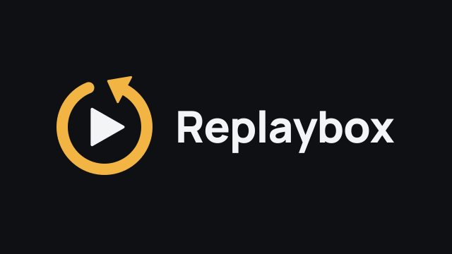

<p align="center">
  
</p>

<p align="center">
  <a href="https://github.com/ouro84/replaybox/releases/latest"></a>
  <a href="https://github.com/ouro84/replaybox/actions/workflows/healthcheck.yml"></a>
  <a href="LICENSE.md"></a>
  
  
</p>

# Replaybox

Replaybox regroupe le replay de TF1+, France TV et M6+ dans une seule app Android TV, sans pub.

Les diffuseurs n'intègrent pas leurs pubs dans les vidéos : c'est leur lecteur qui les ajoute pendant la lecture. Replaybox lit directement les flux vidéo, donc aucune pub n'apparaît. Rien n'est bloqué ni sauté, il n'y a simplement rien à bloquer (constat fait en novembre 2026 : pas de marqueur de pub dans les flux, et des durées identiques à la diffusion TV).

## Ce que fait l'app

- 15 Chaînes : TF1, TMC, TFX, TF1 Séries Films, LCI, France 2, France 3, France 4, France 5, franceinfo, M6, W9, 6ter, Gulli et les programmes originaux M6+.
- Un accueil par Chaîne et par Genre, avec en tête le rail « À suivre » (Épisodes en cours et nouveaux Épisodes des Programmes que tu as épinglés).
- Une recherche sur toutes les Chaînes à la fois, et une grille « Tout voir » par Genre.
- La reprise de lecture là où tu t'es arrêté, « Marquer comme vu » et l'enchaînement automatique sur l'Épisode suivant.
- Des badges sur les Épisodes : « Hier soir », « Nouveau », « Plus que N jours » avant expiration.
- Les sous-titres français activés par défaut, l'audiodescription quand le diffuseur la propose.
- Un mode dégradé : si un diffuseur ne répond pas, l'app affiche le dernier catalogue connu, avec sa date.

## Comptes

- France TV : aucun compte.
- TF1+ : un compte TF1+ (gratuit). TF1 l'exige pour la plupart des Programmes depuis début 2026, quelques-uns se lisent encore sans.
- M6+ : un compte M6+ (gratuit), obligatoire pour lire.

Tu te connectes dans Paramètres, puis TF1+ ou M6+. Tes identifiants sont stockés chiffrés sur le boîtier (Keystore Android) et ne partent que vers le diffuseur concerné. Les contenus que le diffuseur réserve à ses offres payantes restent inaccessibles.

## Paramètres

On y accède par le menu à gauche de l'accueil.

- Sous-titres : taille du texte (Normal, Grand, Très grand) et fond (Contour, Semi-opaque, Opaque), avec un aperçu en direct. Le même réglage existe dans les options du lecteur.
- TF1+, France TV et M6+ : le compte (connexion, déconnexion) et la Santé du diffuseur. La Santé croise la vérification automatique de la nuit (le badge « santé des API » en haut de cette page) et ce que ta box a constaté elle-même.
- À propos : la version installée et la recherche de mise à jour.

## Installation

Il te faut un appareil Android TV 8.0 ou plus récent (l'app est testée sur une Bbox Android TV 11) et une connexion en France : les diffuseurs bloquent leurs flux depuis l'étranger.

### À la main

1. Télécharge le fichier `replaybox-X.Y.Z-release.apk` de la [dernière version](https://github.com/ouro84/replaybox/releases/latest).
2. Copie-le sur la TV, au choix :
   - une clé USB et un gestionnaire de fichiers sur la TV ;
   - l'app Downloader, avec le lien de l'APK ;
   - adb depuis un ordinateur : `adb install -r replaybox-X.Y.Z-release.apk`.
3. Android te demande d'autoriser l'app qui installe (gestionnaire de fichiers, Downloader) à installer des applications inconnues : accepte.

Ensuite l'app se met à jour toute seule. À chaque lancement, elle regarde s'il existe une version plus récente et la télécharge. Un bandeau « Mise à jour X.Y.Z prête » apparaît alors en haut de l'accueil, avec un bouton « Installer ». La première fois, Android te demande d'autoriser Replaybox à installer des applications : accepte, relance l'app (Android la ferme à ce moment-là) et appuie à nouveau sur « Installer ».

### Avec un agent IA

Si tu as un agent de code sur ton ordinateur (Claude Code, Codex, Gemini CLI...), il peut faire l'installation à ta place avec adb. Il ne peut pas toucher la TV, donc cette partie-là est pour toi.

Sur la TV :

1. Active les options pour les développeurs : Paramètres > Préférences de l'appareil > À propos, puis appuie 7 fois sur « Build ».
2. Dans Options pour les développeurs, active « Débogage USB » (et « Débogage réseau » ou « Débogage sans fil » si ta TV le propose).
3. Note l'adresse IP de la TV (Paramètres > Réseau et Internet).
4. Vérifie que la TV et l'ordinateur sont sur le même réseau.

À la première connexion, la TV affiche « Autoriser le débogage USB ? » : accepte (en cochant « Toujours autoriser » si tu veux éviter la question la prochaine fois).

Puis donne ce prompt à ton agent, avec l'IP de ta TV :

```text
Installe l'application Android TV Replaybox sur ma TV.

- IP de la TV : 192.168.1.XX
- Vérifie qu'adb est installé. Sinon, installe les Android SDK Platform-Tools.
- Connecte-toi à la TV : adb connect 192.168.1.XX:5555
  Si la connexion est refusée, demande-moi de valider l'autorisation de débogage sur la TV, puis réessaie.
- Récupère la dernière version via l'API GitHub :
  https://api.github.com/repos/ouro84/replaybox/releases/latest
  Télécharge l'asset dont le nom finit par "-release.apk".
- Installe-le : adb install -r <fichier téléchargé>
- Lance l'app : adb shell monkey -p com.replaybox -c android.intent.category.LEANBACK_LAUNCHER 1
- Ne modifie rien d'autre sur la TV.
```

### Depuis les sources

Il te faut le JDK 11 et le SDK Android (le plus simple : Android Studio).

```sh
./gradlew testDebugUnitTest   # tests
./gradlew assembleDebug       # APK dans app/build/outputs/apk/debug/
```

Ton APK est signé avec ta propre clé de debug, pas celle des versions publiées. Android refuse donc de l'installer par-dessus une version publiée (il faut désinstaller d'abord), et la mise à jour automatique ne pourra pas installer les versions publiées par-dessus la tienne.

## Documentation

- [CONTEXT.md](./CONTEXT.md) : le glossaire du projet (Chaîne, Programme, Saison, Épisode, Flux...).
- [SPEC.md](./SPEC.md) : le fonctionnement des API de chaque diffuseur, tel qu'il a été mesuré.
- [docs/adr/](./docs/adr/) : les décisions d'architecture.
- [PRD.md](./PRD.md) et [ROADMAP.md](./ROADMAP.md) : le produit et ses jalons.

## Avertissement

Replaybox est un projet perso, sans aucun lien avec TF1, France Télévisions ou le groupe M6. Les marques citées appartiennent à leurs propriétaires.

L'app utilise tes propres comptes et lit les flux que les diffuseurs servent à leurs propres applications. Elle ne contourne aucune protection : les vidéos M6+ sont protégées par Widevine, et la licence de lecture est demandée au serveur de M6+ avec ton compte, comme le fait leur app.

Les API des diffuseurs ne sont pas documentées publiquement et peuvent changer du jour au lendemain. Une vérification tourne chaque nuit pour repérer une casse rapidement (badge « santé des API »).

## Licence

[PolyForm Noncommercial 1.0.0](LICENSE.md) : tu peux utiliser, modifier et partager le code à des fins non commerciales. Toute utilisation commerciale est interdite.
